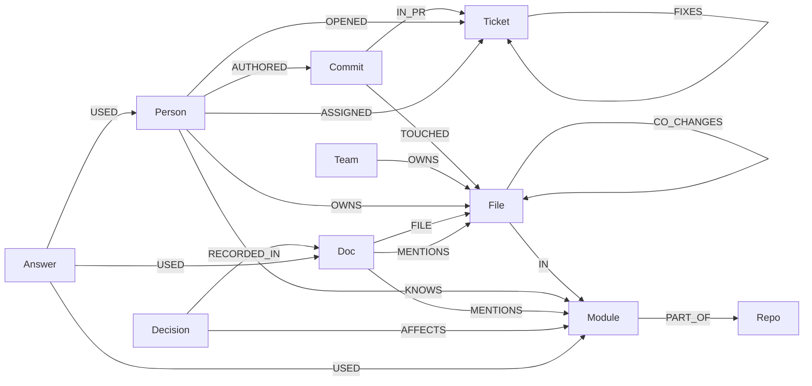
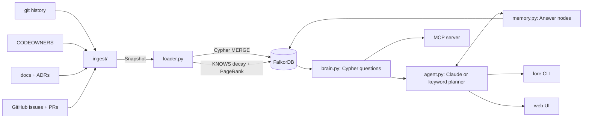

# Lore — the company brain that knows who knows what

> Graph Hacks 2026 · **Track 3: Company Brain** · built on [FalkorDB](https://falkordb.com)

Every company runs on tribal knowledge: who actually understands the billing code, why we picked
Postgres over Mongo, which runbook quietly went out of date last spring. It lives in people's heads,
scattered across commits, docs, CODEOWNERS files, issues and PRs — and it walks out the door when they leave.

**Lore connects all of it into one graph**, then answers the questions a company actually asks:

| Ask | Lore answers with | Graph work |
|---|---|---|
| `lore who "query planner"` | the people who know it **today**, with the commits that prove it | full-text → commits/docs → files → modules ← KNOWS (decayed) |
| `lore leaves alice` | the knowledge that walks out with her, and who should take it over | KNOWS share per module, successors via CO_CHANGES neighbours |
| `lore stale` | docs that no longer match the code, and who should fix them | doc → MENTIONS → files changed / deleted since the doc's last edit |
| `lore why "graph storage format"` | the decision, its ADR, the people and PRs behind it | full-text → Decision → RECORDED_IN → Doc ← commits ← people, → PRs |
| `lore route "crash on bulk insert"` | who should pick up a new issue, balanced by their open load | similar tickets → FIXES → PR ← commits → files → modules ← KNOWS |
| `lore ghosts src/billing.py` | files that secretly change together with yours | CO_CHANGES (mined from history, not imports) |
| `lore ask "anything"` | an agent that picks and chains these tools, cites its sources, and remembers answers | all of the above + `(:Answer)-[:USED]->` memory |
| `lore onboard "replication"` | who to meet, what to read, why it's built that way, where to start | all of the above, plus PageRank over CO_CHANGES |

Everything is built from **public data only**: a repo's git history, its CODEOWNERS, its docs/ADRs/RFCs,
and its public GitHub issues and PRs. Point it at a real organization — our demo uses FalkorDB's own repos.

## What makes it different

- **Knowledge decays.** `KNOWS` is weighted with a 180-day half-life, so "who knows X" means who knows it *now*,
  not who wrote it in 2019. `lore refresh` keeps the brain current after every ingest.
- **It finds coupling nobody wrote down.** `CO_CHANGES` edges come from history: files that change together
  even though nothing imports anything. Documentation can't tell you that; the graph can.
- **Every answer has a path.** Each answer comes with the commits, docs, PRs and edges that produced it.
- **Identity resolution.** Git emails and GitHub logins are merged (noreply addresses, squash-merge `(#123)` commits),
  so one person is one node.
- **One graph per company.** `--graph acme` uses FalkorDB's multi-graph support to isolate tenants in one instance.

## Graph model



| Node | Key properties | From |
|---|---|---|
| `Person` | `key` (`gh:login`, or `git:` + a one-way hash of the email), `name`, `commits`, `last_active` | git + GitHub |
| `Team` | `name` (`org/team`) | CODEOWNERS |
| `Repo`, `Module`, `File` | `key`, `path`, `alive`, `rank` (PageRank) | git |
| `Commit` | `sha`, `message`, `ts` | git log |
| `Doc` | `path`, `title`, `text` (full-text indexed) | Markdown/RST in the repo |
| `Decision` | `title`, `status`, `date` | docs under `adr/`, `rfcs/`, `decisions/`, `design-docs/` |
| `Answer` | `question`, `answer`, `asof` (the agent's memory) | the agent |
| `Ticket` | `kind` (issue/pr), `number`, `title`, `body`, `state`, `url` | GitHub REST API |

| Edge | Properties | Meaning |
|---|---|---|
| `CO_CHANGES` | `count`, `confidence` | a → b: when a changes, b changes with probability `confidence` |
| `KNOWS` | `score`, `commits`, `last` | recency-decayed expertise, derived by Cypher in `refresh()` |

Full-text indexes: `Doc(title, text)`, `Ticket(title, body)`, `Commit(message)`.

## The Cypher the product depends on

All queries live in [`lore/brain.py`](lore/brain.py) (questions) and [`lore/loader.py`](lore/loader.py) (derived knowledge).
The core ones:

**Recency-decayed expertise** (`loader.refresh`)
```cypher
MATCH (p:Person)-[:AUTHORED]->(c:Commit)-[:TOUCHED]->(:File)-[:IN]->(m:Module)
WITH DISTINCT p, m, c
WITH p, m, count(c) AS commits, max(c.ts) AS last,
     sum(exp(-0.6931 * ($now - c.ts) / ($half * 86400.0))) AS score
MERGE (p)-[k:KNOWS]->(m)
SET k.score = score, k.commits = commits, k.last = last
```

**What walks out the door** (`brain.Q_DEPARTURE`)
```cypher
MATCH (p:Person {key: $person})-[k:KNOWS]->(m:Module)
WHERE k.commits >= 2
OPTIONAL MATCH (o:Person)-[k2:KNOWS]->(m)
WHERE o <> p AND k2.last >= $active_since
WITH m, k, sum(coalesce(k2.score, 0)) AS others, count(o) AS active_people
WITH m, k, active_people, k.score / (k.score + others + 0.000001) AS share
WHERE share >= $min_share
RETURN m.path AS module, share, k.commits AS commits, active_people
ORDER BY share * k.score DESC
```

**Successor when nobody else works in the module** (`brain.Q_SUCCESSOR_ADJACENT`)
```cypher
MATCH (m:Module {key: $module})<-[:IN]-(:File)-[cc:CO_CHANGES]->(:File)-[:IN]->(m2:Module)<-[k:KNOWS]-(o:Person)
WHERE m2 <> m AND o.key <> $person AND k.last >= $active_since
RETURN o.name AS name, sum(cc.confidence * k.score) AS score, m2.path AS via
ORDER BY score DESC LIMIT 2
```

**Stale docs** (`brain.Q_STALE_DOCS`)
```cypher
MATCH (d:Doc)-[:FILE]->(:File)<-[:TOUCHED]-(dc:Commit)
WITH d, max(dc.ts) AS doc_updated
MATCH (d)-[:MENTIONS]->(f:File)
OPTIONAL MATCH (f)<-[:TOUCHED]-(c:Commit) WHERE c.ts > doc_updated
WITH d, doc_updated, f, count(c) AS changes
WHERE changes >= $min_changes OR f.alive = false
RETURN d.path, doc_updated, collect({file: f.path, changes: changes, deleted: NOT f.alive}) AS drift
```

**Route a new issue** (`brain.Q_ROUTE_MODULES`)
```cypher
CALL db.idx.fulltext.queryNodes('Ticket', $q) YIELD node, score
WITH node, score ORDER BY score DESC LIMIT 20
MATCH (node)<-[:FIXES*0..1]-(:Ticket)<-[:IN_PR]-(:Commit)-[:TOUCHED]->(:File)-[:IN]->(m:Module)
RETURN m.path AS module, sum(score) AS relevance, collect(DISTINCT node.number) AS similar
ORDER BY relevance DESC LIMIT 5
```

**Graph algorithm: central files** (`loader.refresh`)
```cypher
CALL algo.pageRank('File', 'CO_CHANGES') YIELD node, score
SET node.rank = score
```

## The agent

`lore ask "…"` and the web UI hand your question to an agent whose tools are the brain queries above, plus a
read-only `cypher` tool for anything else ([`lore/agent.py`](lore/agent.py)).

- **With `ANTHROPIC_API_KEY` set**, Claude (`claude-opus-5-5`) plans: it picks tools, chains them
  (e.g. `find_person` → `departure`), and must cite the commits, docs and PRs it used.
- **Without a key**, a built-in keyword planner routes the question to the right tool, so the demo always runs.
- Writes are impossible through the agent: the `cypher` tool rejects write clauses and runs via FalkorDB's `GRAPH.RO_QUERY`.

## Memory that knows when it's out of date

Every answer is saved in the graph as an `(:Answer)` node with `USED` edges to the modules, docs, people and tickets
it was built from ([`lore/memory.py`](lore/memory.py)). Ask the same thing later and Lore:

- **recalls** the answer instantly if none of that evidence changed, or
- **notices it's stale** ("since then, 14 commits landed in `src/graph`") and re-answers.

```cypher
MATCH (a:Answer {key: $key})-[:USED]->(m:Module)<-[:IN]-(:File)<-[:TOUCHED]-(c:Commit)
WHERE c.ts > a.asof
RETURN m.path AS what, count(DISTINCT c) AS changes
```

Try it with time travel: `lore ingest <repo> --until 2025-06-01`, ask a question, then `lore ingest <repo>` again
and ask the same question.

## Run it

Requirements: Python 3.10+, git, Docker (or a FalkorDB Cloud instance).

```bash
docker compose up -d                       # FalkorDB on :6379, FalkorDB Browser on http://localhost:3000
python3 -m venv .venv && .venv/bin/pip install -e ".[dev]"
cp .env.example .env                       # optional: GITHUB_TOKEN, ANTHROPIC_API_KEY

.venv/bin/lore ingest FalkorDB/FalkorDB    # clone + load a public org repo (repeat for more repos)
.venv/bin/lore stats

.venv/bin/uvicorn lore.web:app --port 8000 # web UI: http://localhost:8000
```

Every CLI command:

```bash
lore scan <repo>            # parse only, no database
lore ingest <repo>          # load (options: --until DATE, --since DATE, --no-github, --graph NAME)
lore ask "<anything>"       # the agent, with memory
lore who "<topic>"          # who knows about it today
lore leaves "<person>"      # what walks out the door
lore stale                  # docs that no longer match the code
lore why "<question>"       # trace a decision
lore route "<issue text>"   # who should pick it up
lore ghosts <file>...       # hidden coupling
lore onboard "<topic>"      # onboarding plan
lore refresh                # recompute KNOWS + PageRank
```

Use it from any AI assistant over MCP (stdio):

```json
{ "mcpServers": { "lore": { "command": "/path/to/lore/.venv/bin/python", "args": ["-m", "lore.mcp_server"],
  "cwd": "/path/to/lore" } } }
```

Tests (no database needed): `.venv/bin/pytest`

## Architecture



```
lore/
  ingest/          parse a repo into plain data (testable without a database)
    git_history.py   commits, files, modules, co-change mining
    codeowners.py    CODEOWNERS → ownership (GitHub's last-match-wins rules)
    docs.py          docs, what they mention, ADR/RFC decisions
    github.py        public issues and PRs
    __init__.py      Snapshot + identity resolution
  loader.py        Snapshot → FalkorDB, then derived KNOWS + PageRank
  brain.py         every question as Cypher (these are the agent's tools)
  agent.py         the agent: Claude tool loop or keyword planner, with a trace of every tool call
  memory.py        Answer nodes, USED evidence edges, staleness detection
  web.py, static/  FastAPI + one-page UI with the answer's graph path
  mcp_server.py    the brain as MCP tools
  cli.py           `lore …`
```

## Graph Hacks submission checklist

| Rule | Where |
|---|---|
| FalkorDB is the primary database and does the real work | every answer is a Cypher traversal; remove FalkorDB and nothing works |
| Track | **Company Brain** |
| Public source repo | this repository |
| README with setup + graph data model | this file: [Graph model](#graph-model), [Run it](#run-it) |
| Cypher queries / graph algorithms the product depends on | [above](#the-cypher-the-product-depends-on), all in `lore/brain.py`, `lore/loader.py`, `lore/memory.py`; PageRank via `algo.pageRank` |
| Demo video | link in the submission |
| Live deployment or full local setup | [Run it](#run-it) (local, Docker) |
| Allowed data only | public GitHub repos, issues and PRs only; nothing private or login-protected; email addresses are never stored (people are keyed by GitHub login or a one-way hash) |
| AI coding assistants disclosed | [below](#ai-disclosure) |

## AI disclosure

We used Claude Code (Anthropic) as a coding assistant during the hackathon, as the rules allow. The team reviewed,
ran and understands every query and design decision, and can explain the graph model, queries and architecture.
At runtime, the agent can optionally use Claude (`claude-opus-5-5`) as its planner.
